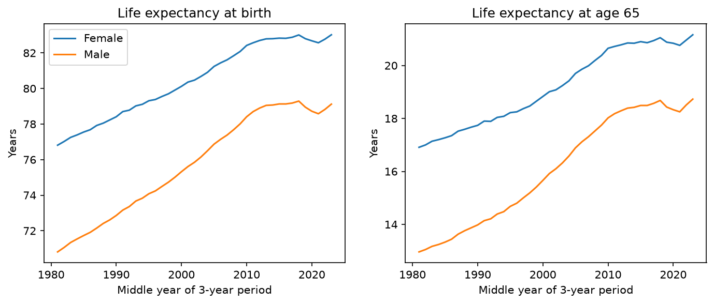
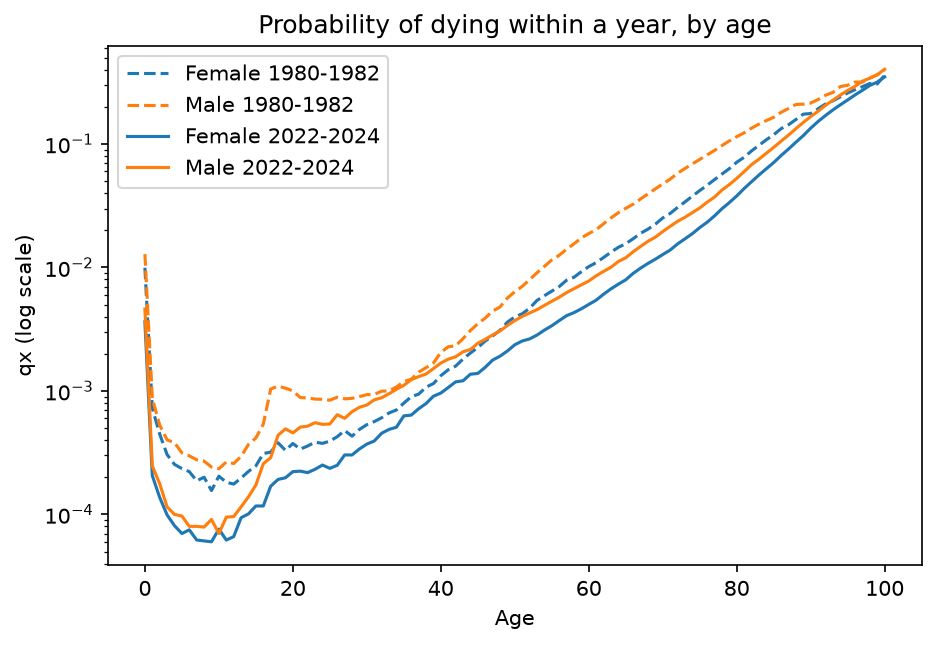

# UK life expectancy, 1980–2024

An analysis of ONS national life tables asking how UK life expectancy has
changed since 1980 and what that means for pension costs.

## Key findings
- Life expectancy at birth rose from 70.8 to 79.1 years for men and from 76.8 to 83.0 for women.
- At age 65 the gain was 5.8 years for men and 4.3 for women, which means that many more years of pension paid per person.
- Progress stalled in the 2010s and dipped during the pandemic.
- Adult mortality follows the Gompertz law: risk doubles about every 7.1 years of age for women and every 7.5 for men.

The chart below shows the probability of dying within a year at each age, on a log scale.
From about age 30 onwards the lines are close to straight, which is the Gompertz law in action:
risk rises exponentially with age. The gap between the dashed (1980–82) and solid (2022–24)
lines shows how much mortality has fallen at almost every age, with the largest improvements
in middle age. Men have higher mortality than women at nearly every age, most visibly in the
late teens and twenties.

## Method
1. `01_clean.py` reshapes the ONS workbook into one tidy table and runs
   automated checks (qx between 0 and 1, lx = 100,000 at birth, ages 0–100).
2. `02_load_sql.py` loads it into SQLite and answers questions in SQL.
3. `03_analysis.py` produces the charts and fits a Gompertz model.

Results were checked against the headline figures in the ONS bulletin.

## How to run
    pip install -r requirements.txt
    python src/01_clean.py
    python src/02_load_sql.py
    python src/03_analysis.py

## Limitations
- These are period life tables, which assume today's death rates never change.
  Cohort measures that allow for future improvement come out higher.
- Three-year periods overlap, so neighbouring points are not independent.

## Data
Source: Office for National Statistics, National life tables, UK.
Contains public sector information licensed under the Open Government Licence v3.0.